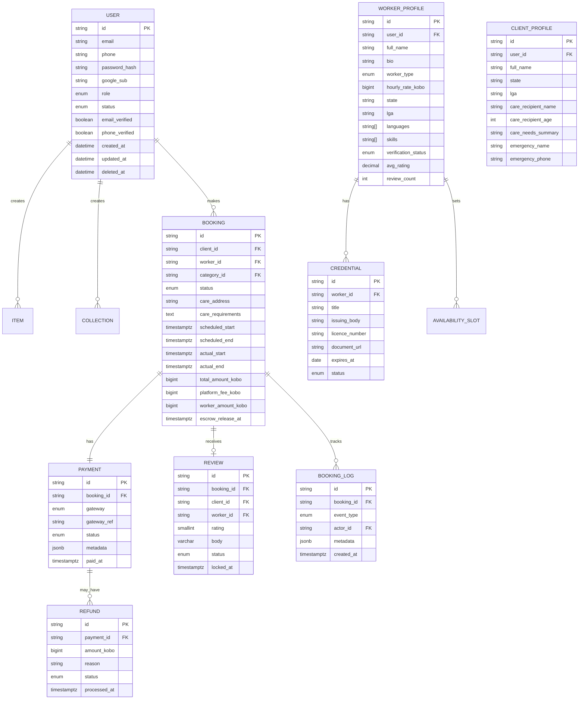
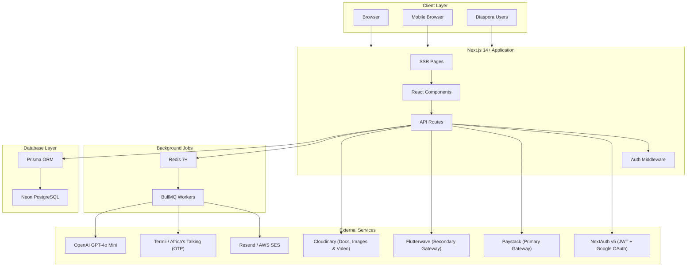
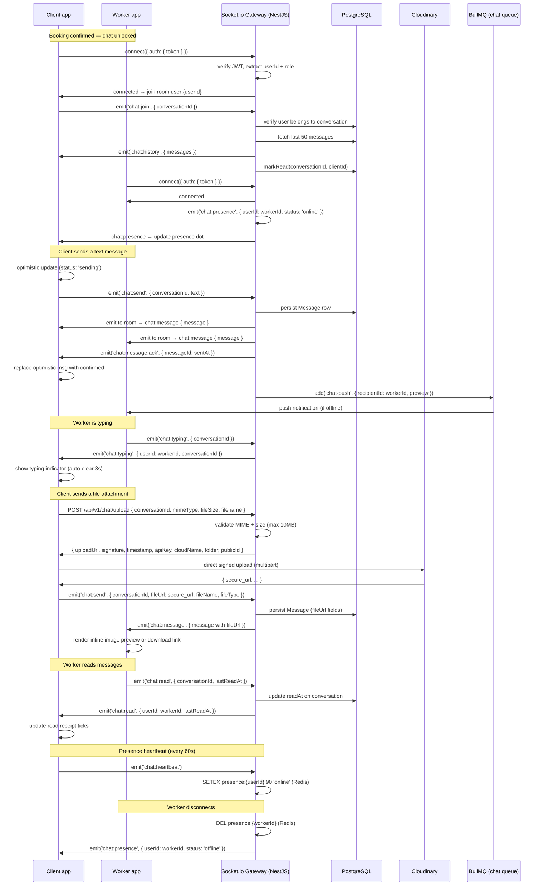

# CareGiverNG - Project Overview

> Nigeria's trusted healthcare workforce marketplace

---

## 📋 Table of Contents

- [Problem Statement](#-problem-statement)
- [Target Users](#-target-users)
- [Service Categories](#-service-categories)
- [User Roles](#-user-roles)
- [Features](#-features)
- [Business Model](#-business-model)
- [Data Architecture](#-data-architecture)
- [Tech Stack](#-tech-stack)
- [Trust & Safety](#-trust--safety)
- [UI/UX Guidelines](#-uiux-guidelines)
- [Roadmap](#-roadmap)
- [Success Metrics](#-success-metrics)
- [Next Steps](#-next-steps)

---

## 🎯 Problem Statement

Families in Nigeria who need caregivers are forced to rely on fragmented, unverified sources:

| Resource            | Common Location                              |
| ------------------- | -------------------------------------------- |
| Caregiver discovery | WhatsApp groups, referrals, word of mouth    |
| Credentials         | Unverified claims — no way to check          |
| Pricing             | Negotiated ad hoc — no market standard       |
| Payments            | Cash upfront with no recourse                |
| Accountability      | No reviews, no ratings, no formal complaints |
| Diaspora access     | Phone calls to local contacts                |

**The Result:** Families cannot trust who enters their home. Workers lack a fair, transparent earning platform. Diaspora Nigerians cannot reliably arrange care for relatives from abroad.

**The Solution:** CareGiverNG provides ONE verified, searchable, AI-enhanced marketplace for discovering, booking, paying, and reviewing healthcare workers and students — with trust and safety built in from day one.

---

## 👥 Target Users

| User Type                  | Primary Needs                                              |
| -------------------------- | ---------------------------------------------------------- |
| **Families**               | Verified caregivers for parents, children, or relatives    |
| **Diaspora Nigerians**     | Remote arrangement of care for family members in Nigeria   |
| **Patients**               | Qualified professionals for post-surgery or ongoing care   |
| **Healthcare Workers**     | Fair pay, flexible scheduling, and a professional profile  |
| **Healthcare Students**    | Paid experience, exposure, and a verifiable track record   |
| **Agencies** *(Phase 2)*   | Tools to manage multiple workers and assignments           |

---

## 🏥 Service Categories

| Category                  | Icon | Services Included                                           | Who Can Offer     | MVP |
| ------------------------- | ---- | ----------------------------------------------------------- | ----------------- | :-: |
| **Elderly Care**          | 👴   | Companion care, medication reminders, daily living support  | HW + HS           | ✅  |
| **Special Needs Care**    | 🤝   | ASD, Cerebral Palsy, Down Syndrome, Developmental support   | HW + HS           | ✅  |
| **Post-Hospital Care**    | 🏥   | Recovery monitoring, mobility assistance, wound care        | HW only           | ✅  |
| **Nursing Care**          | 💉   | Clinical care — IV, medication administration, monitoring   | Licensed HW only  | ✅  |
| **Child Care Support**    | 👶   | Specialised assistance for children with additional needs   | HW + HS           | ✅  |
| **Physiotherapy Assist**  | 🦽   | Mobility and rehabilitation support                         | HW (Physio) + HS  | ✅  |
| **Overnight Care**        | 🌙   | Night-shift caregiving services                             | HW + HS           | ✅  |
| **Live-In Care**          | 🏠   | Long-term residential caregiving                            | HW only           | ✅  |

> **Note:** Healthcare Students (HS) can only offer non-regulated support duties. Regulated services (wound care, IV administration, clinical monitoring) are restricted to licensed Healthcare Workers (HW).

---

## 👤 User Roles

### Role Capability Matrix

| Capability                        | Client | HW | HS | Admin |
| --------------------------------- | :----: | :--: | :--: | :---: |
| Register & log in                 | ✅ | ✅ | ✅ | ✅ |
| Build public profile              | ❌ | ✅ | ✅ | ❌ |
| Submit identity verification      | ❌ | ✅ | ✅ | ❌ |
| Upload professional credentials   | ❌ | ✅ | ❌ | ❌ |
| Manage availability calendar      | ❌ | ✅ | ✅ | ❌ |
| Search caregivers                 | ✅ | ❌ | ❌ | ❌ |
| Send booking request              | ✅ | ❌ | ❌ | ❌ |
| Accept / decline bookings         | ❌ | ✅ | ✅ | ❌ |
| Mark job started / completed      | ❌ | ✅ | ✅ | ❌ |
| Make payment                      | ✅ | ❌ | ❌ | ❌ |
| Receive payout                    | ❌ | ✅ | ✅ | ❌ |
| Leave review                      | ✅ | ❌ | ❌ | ❌ |
| Submit incident report            | ✅ | ✅ | ✅ | ❌ |
| Verify users & credentials        | ❌ | ❌ | ❌ | ✅ |
| Manage disputes                   | ❌ | ❌ | ❌ | ✅ |
| Issue refunds                     | ❌ | ❌ | ❌ | ✅ |
| Moderate reviews                  | ❌ | ❌ | ❌ | ✅ |

---

## ✨ Features

### A. Core Platform Features

- 🔍 **Caregiver Search** — Filter by location, service category, availability, rating, price, and experience
- 📅 **Booking System** — Full lifecycle: request → accept → confirm → start → complete
- 💳 **Escrow Payments** — Funds held until 24 hours after job completion
- ⭐ **Reviews & Ratings** — 1–5 star ratings with written reviews per completed booking
- 📌 **Pin & Favourite** — Pin items to top; mark favourites for quick access
- 🕐 **Recently Used** — Surface recently viewed or booked caregivers
- 🌙 **Dark Mode** — Default; light mode optional

### B. Worker Features

- 🪪 **Identity Verification** — NIN + government ID + selfie review by admin (48hr SLA)
- 📜 **Credential Upload** — Professional certifications with expiry tracking and auto-alerts
- 📆 **Availability Calendar** — Recurring weekly schedule, date blocks, exam period locks (HS), and a full pause toggle
- 💰 **Earnings Dashboard** — Total earned, pending escrow, available for payout, transaction history
- 🏦 **Bank Account Management** — Add and verify Nigerian bank accounts via Paystack/Flutterwave resolve API

### C. Client Features

- 👤 **Care Profile** — Care recipient details, emergency contact, and care needs summary pre-fill booking requests
- 📋 **Booking Management** — Upcoming, active, completed, and cancelled booking tabs with re-book shortcut
- 📣 **Incident Reporting** — Category-based reports with image upload; safeguarding cases auto-escalated

### D. Admin Features

- 🗂️ **Verification Queue** — Review identity and credential submissions with approve / reject / request-more-docs actions
- ⚖️ **Dispute Resolution** — Full/partial refund decisions with 72-hour SLA tracking
- 💼 **Financial Dashboard** — All transactions, commission revenue, payout queue, CSV export
- 📊 **Review Moderation** — Flag, archive, and remove reviews; worker quality trend alerts
- 🔐 **Role Management** — Super Admin, Verification Officer, Support Agent, Finance Officer

### E. AI Features *(Pro — Phase 2)*

- 🤖 **AI Caregiver Matching** — ML-based recommendations from client history and care needs
- 📝 **AI Care Visit Summaries** — Structured post-visit reports auto-generated from worker notes
- 💡 **AI Credential Verification Assist** — Flags anomalies in uploaded credential documents

---

## 💰 Business Model

### Pricing Tiers

```
Free Tier                          Pro Tier — ₦8,000/mo or ₦72,000/yr
─────────────────────              ─────────────────────────────────────
✅ Basic search & discovery        ✅ Everything in Free
✅ Browse caregiver profiles       ✅ Unlimited bookings
✅ Up to 3 bookings/month          ✅ File & image uploads
❌ File uploads                    ✅ AI caregiver matching (Phase 2)
❌ AI features                     ✅ AI visit summaries (Phase 2)
❌ Priority support                ✅ Data export (JSON/CSV)
                                   ✅ Priority support
```

> **Development Note:** During development, all users can access all features. Pro gating will be enabled before launch.

### Commission Mechanics

```
Example booking: ₦50,000 for a 10-hour shift at ₦5,000/hr

  Gross booking value        ₦50,000
  Platform commission (10%)  ₦ 5,000
  Worker receives (90%)      ₦45,000

  VAT on commission (7.5%)   ₦   375   → Platform's FIRS liability
  Net platform revenue       ₦ 4,625

  All monetary values are stored in kobo (× 100) to avoid floating-point errors.
```

### Cancellation & Refund Policy

| Scenario                               | Client Refund | Worker Compensation          |
| -------------------------------------- | :-----------: | ---------------------------- |
| Client cancels before worker accepts   | 100%          | None                         |
| Client cancels >24hrs before service   | 100%          | None                         |
| Client cancels 4–24hrs before service  | 50%           | 50% inconvenience fee        |
| Client cancels <4hrs before service    | 0%            | Full worker amount released  |
| Worker cancels (any time)              | 100%          | Cancellation strike logged   |
| Worker no-show (admin confirmed)       | 100%          | Misconduct flag added        |
| Admin cancels (safety / policy breach) | 100%          | None                         |
| Completed booking — disputed           | Admin decides | Admin decides                |

---

## 🗄️ Data Architecture

### Entity Relationship Diagram



### Prisma Schema

```prisma
// prisma/schema.prisma

generator client {
  provider = "prisma-client-js"
}

datasource db {
  provider = "postgresql"
  url      = env("DATABASE_URL")
}

// ============================================
// ENUMS
// ============================================
enum Role {
  CLIENT
  HW
  HS
  ADMIN
}

enum UserStatus {
  PENDING
  ACTIVE
  SUSPENDED
  DEACTIVATED
}

enum WorkerType {
  HW
  HS
}

enum VerificationStatus {
  PENDING
  VERIFIED
  REJECTED
  SUSPENDED
}

enum BookingStatus {
  PENDING
  ACCEPTED
  CONFIRMED
  IN_PROGRESS
  COMPLETED
  CANCELLED
  DISPUTED
}

enum PaymentGateway {
  PAYSTACK
  FLUTTERWAVE
}

enum PaymentStatus {
  PENDING
  SUCCESSFUL
  FAILED
  REFUNDED
  PARTIAL_REFUNDED
}

enum CredentialStatus {
  PENDING
  VERIFIED
  REJECTED
  EXPIRED
}

enum ReviewStatus {
  PUBLISHED
  FLAGGED
  REMOVED
}

// ============================================
// USER
// ============================================
model User {
  id             String     @id @default(cuid())
  email          String?    @unique
  phone          String?    @unique
  emailVerified  Boolean    @default(false)
  phoneVerified  Boolean    @default(false)
  name           String?
  passwordHash   String?
  googleSub      String?    @unique
  role           Role
  status         UserStatus @default(PENDING)
  createdAt      DateTime   @default(now())
  updatedAt      DateTime   @updatedAt
  deletedAt      DateTime?

  // Relations
  clientProfile  ClientProfile?
  workerProfile  WorkerProfile?
  bookingsAsClient Booking[] @relation("ClientBookings")
  bookingsAsWorker Booking[] @relation("WorkerBookings")
  refreshTokens  RefreshToken[]
  notifications  Notification[]
  accounts       Account[]
  sessions       Session[]

  @@index([role, status])
  @@map("users")
}

// ============================================
// NEXTAUTH MODELS
// ============================================
model Account {
  id                String  @id @default(cuid())
  userId            String
  type              String
  provider          String
  providerAccountId String
  refresh_token     String? @db.Text
  access_token      String? @db.Text
  expires_at        Int?
  token_type        String?
  scope             String?
  id_token          String? @db.Text
  session_state     String?

  user User @relation(fields: [userId], references: [id], onDelete: Cascade)

  @@unique([provider, providerAccountId])
  @@map("accounts")
}

model Session {
  id           String   @id @default(cuid())
  sessionToken String   @unique
  userId       String
  expires      DateTime

  user User @relation(fields: [userId], references: [id], onDelete: Cascade)

  @@map("sessions")
}

// ============================================
// PROFILES
// ============================================
model ClientProfile {
  id                 String  @id @default(cuid())
  userId             String  @unique
  fullName           String
  avatarUrl          String?
  state              String
  lga                String
  careRecipientName  String?
  careRecipientAge   Int?
  careRecipientRel   String?
  careNeedsSummary   String? @db.Text
  emergencyName      String
  emergencyPhone     String
  createdAt          DateTime @default(now())
  updatedAt          DateTime @updatedAt

  user User @relation(fields: [userId], references: [id], onDelete: Cascade)

  @@map("client_profiles")
}

model WorkerProfile {
  id                 String             @id @default(cuid())
  userId             String             @unique
  fullName           String
  avatarUrl          String?
  bio                String?            @db.VarChar(500)
  workerType         WorkerType
  yearsExperience    Int?
  institution        String?
  gradYear           Int?
  fieldOfStudy       String?
  hourlyRateKobo     BigInt
  state              String
  lga                String
  languages          String[]           @default([])
  skills             String[]           @default([])
  isAvailable        Boolean            @default(true)
  verificationStatus VerificationStatus @default(PENDING)
  avgRating          Decimal            @default(0.00) @db.Decimal(3, 2)
  reviewCount        Int                @default(0)
  createdAt          DateTime           @default(now())
  updatedAt          DateTime           @updatedAt

  user              User               @relation(fields: [userId], references: [id], onDelete: Cascade)
  credentials       Credential[]
  availabilitySlots AvailabilitySlot[]
  availabilityBlocks AvailabilityBlock[]

  @@index([state, lga, workerType, verificationStatus, avgRating])
  @@map("worker_profiles")
}

// ============================================
// CREDENTIALS
// ============================================
model Credential {
  id            String           @id @default(cuid())
  workerId      String
  title         String
  issuingBody   String
  licenceNumber String?
  documentUrl   String
  expiresAt     DateTime?        @db.Date
  status        CredentialStatus @default(PENDING)
  adminNote     String?          @db.Text
  createdAt     DateTime         @default(now())
  updatedAt     DateTime         @updatedAt

  workerProfile WorkerProfile @relation(fields: [workerId], references: [id], onDelete: Cascade)

  @@map("credentials")
}

// ============================================
// AVAILABILITY
// ============================================
model AvailabilitySlot {
  id        String @id @default(cuid())
  workerId  String
  dayOfWeek Int    // 0 = Sunday, 6 = Saturday
  startTime String // "08:00"
  endTime   String // "18:00"

  workerProfile WorkerProfile @relation(fields: [workerId], references: [id], onDelete: Cascade)

  @@map("availability_slots")
}

model AvailabilityBlock {
  id        String   @id @default(cuid())
  workerId  String
  startDate DateTime @db.Date
  endDate   DateTime @db.Date
  reason    String?

  workerProfile WorkerProfile @relation(fields: [workerId], references: [id], onDelete: Cascade)

  @@map("availability_blocks")
}

// ============================================
// SERVICE CATEGORIES
// ============================================
model ServiceCategory {
  id          String  @id @default(cuid())
  name        String  @unique
  description String?
  isRestricted Boolean @default(false) // true = HW only

  bookings Booking[]

  @@map("service_categories")
}

// ============================================
// BOOKING
// ============================================
model Booking {
  id                String        @id @default(cuid())
  clientId          String
  workerId          String
  categoryId        String
  status            BookingStatus @default(PENDING)
  careAddress       String        @db.Text
  careRequirements  String?       @db.Text
  scheduledStart    DateTime
  scheduledEnd      DateTime
  actualStart       DateTime?
  actualEnd         DateTime?
  durationHours     Decimal       @db.Decimal(5, 2)
  hourlyRateKobo    BigInt
  totalAmountKobo   BigInt
  platformFeeKobo   BigInt
  workerAmountKobo  BigInt
  cancelledBy       String?
  cancellationReason String?      @db.Text
  escrowReleaseAt   DateTime?
  createdAt         DateTime      @default(now())
  updatedAt         DateTime      @updatedAt

  client   User            @relation("ClientBookings", fields: [clientId], references: [id])
  worker   User            @relation("WorkerBookings", fields: [workerId], references: [id])
  category ServiceCategory @relation(fields: [categoryId], references: [id])
  payment  Payment?
  review   Review?
  logs     BookingLog[]
  reports  Report[]

  @@index([clientId, workerId, status, scheduledStart])
  @@map("bookings")
}

model BookingLog {
  id        String   @id @default(cuid())
  bookingId String
  eventType String
  actorId   String?
  metadata  Json?
  createdAt DateTime @default(now())

  booking Booking @relation(fields: [bookingId], references: [id], onDelete: Cascade)

  @@map("booking_logs")
}

// ============================================
// PAYMENTS
// ============================================
model Payment {
  id         String         @id @default(cuid())
  bookingId  String         @unique
  clientId   String
  amountKobo BigInt
  currency   String         @default("NGN")
  gateway    PaymentGateway
  gatewayRef String         @unique
  status     PaymentStatus  @default(PENDING)
  paidAt     DateTime?
  metadata   Json?
  createdAt  DateTime       @default(now())
  updatedAt  DateTime       @updatedAt

  booking Booking  @relation(fields: [bookingId], references: [id])
  refunds Refund[]

  @@map("payments")
}

model Refund {
  id          String   @id @default(cuid())
  paymentId   String
  amountKobo  BigInt
  reason      String
  status      String   @default("PENDING")
  processedAt DateTime?
  createdAt   DateTime @default(now())

  payment Payment @relation(fields: [paymentId], references: [id])

  @@map("refunds")
}

// ============================================
// REVIEWS
// ============================================
model Review {
  id            String       @id @default(cuid())
  bookingId     String       @unique
  clientId      String
  workerId      String
  rating        Int          // 1–5
  body          String?      @db.VarChar(500)
  status        ReviewStatus @default(PUBLISHED)
  removedReason String?      @db.Text
  editedAt      DateTime?
  lockedAt      DateTime?
  createdAt     DateTime     @default(now())
  updatedAt     DateTime     @updatedAt

  booking Booking @relation(fields: [bookingId], references: [id])

  @@map("reviews")
}

// ============================================
// REPORTS
// ============================================
model Report {
  id          String   @id @default(cuid())
  bookingId   String?
  reporterId  String
  accusedId   String
  category    String
  description String   @db.Text
  status      String   @default("OPEN")
  outcome     String?  @db.Text
  createdAt   DateTime @default(now())
  updatedAt   DateTime @updatedAt

  booking Booking? @relation(fields: [bookingId], references: [id])

  @@map("reports")
}

// ============================================
// REFRESH TOKENS
// ============================================
model RefreshToken {
  id          String    @id @default(cuid())
  userId      String
  tokenHash   String
  deviceHint  String?
  expiresAt   DateTime
  revokedAt   DateTime?
  replacedBy  String?
  createdAt   DateTime  @default(now())

  user User @relation(fields: [userId], references: [id], onDelete: Cascade)

  @@index([tokenHash, userId, expiresAt])
  @@map("refresh_tokens")
}

// ============================================
// NOTIFICATIONS
// ============================================
model Notification {
  id        String   @id @default(cuid())
  userId    String
  type      String
  title     String
  body      String
  isRead    Boolean  @default(false)
  metadata  Json?
  createdAt DateTime @default(now())

  user User @relation(fields: [userId], references: [id], onDelete: Cascade)

  @@index([userId, isRead])
  @@map("notifications")
}
```

### Seed Data for Service Categories

```typescript
// prisma/seed.ts

import { PrismaClient } from '@prisma/client';

const prisma = new PrismaClient();

const serviceCategories = [
  { name: 'Elderly Care',           description: 'Companion care, medication reminders, daily living support', isRestricted: false },
  { name: 'Special Needs Care',     description: 'ASD, Cerebral Palsy, Down Syndrome, Developmental Disability support', isRestricted: false },
  { name: 'Post-Hospital Care',     description: 'Recovery monitoring, mobility assistance, wound care support', isRestricted: true },
  { name: 'Nursing Care',           description: 'Clinical care — IV, medication administration, medical monitoring', isRestricted: true },
  { name: 'Child Care Support',     description: 'Specialised assistance for children with additional support needs', isRestricted: false },
  { name: 'Physiotherapy Assist',   description: 'Mobility and rehabilitation support', isRestricted: false },
  { name: 'Overnight Care',         description: 'Night-shift caregiving services', isRestricted: false },
  { name: 'Live-In Care',           description: 'Long-term residential caregiving', isRestricted: true },
];

async function main() {
  console.log('Seeding service categories...');

  for (const category of serviceCategories) {
    await prisma.serviceCategory.upsert({
      where: { name: category.name },
      update: {},
      create: category,
    });
  }

  console.log('Seeding complete!');
}

main()
  .catch((e) => {
    console.error(e);
    process.exit(1);
  })
  .finally(async () => {
    await prisma.$disconnect();
  });
```

---

## 🛠️ Tech Stack

### Architecture Diagram



### Technology Choices

| Category            | Technology                       | Notes                                            |
| ------------------- | -------------------------------- | ------------------------------------------------ |
| **Framework**       | Next.js 14+ / React              | SSR for SEO, API routes, single codebase         |
| **Language**        | TypeScript                       | Type safety throughout                           |
| **Database**        | Neon PostgreSQL                  | Serverless Postgres with connection pooling      |
| **ORM**             | Prisma                           | Full type safety; migrations-only workflow       |
| **Cache & Queues**  | Redis 7+ + BullMQ                | Rate limiting, escrow jobs, notification queue   |
| **File Storage**    | Cloudinary                       | Profile photos, IDs, certificates, documents, video |
| **Authentication**  | NextAuth v5                      | JWT, Google OAuth, email/password + OTP          |
| **Payments**        | Paystack + Flutterwave           | NGN-first; both integrated for redundancy        |
| **SMS / OTP**       | Termii or Africa's Talking       | Nigerian SMS gateways with reliable local reach  |
| **Email**           | Resend or AWS SES                | Async dispatch via BullMQ queue                  |
| **AI**              | OpenAI GPT-4o Mini               | Cost-effective for matching and summaries        |
| **Styling**         | Tailwind CSS v4 + shadcn/ui      | Modern, accessible components; dark mode default |
| **Admin Dashboard** | Angular 17+ + Tailwind           | Structured framework for data-heavy admin UI     |

### Important Development Notes

> ⚠️ **Database Migrations**
>
> **NEVER** use `prisma db push` or directly update the database structure.
>
> Always create migrations that run in development first, then production:
>
> ```bash
> # Create migration
> npx prisma migrate dev --name <migration_name>
>
> # Apply to production
> npx prisma migrate deploy
> ```

> ⚠️ **Monetary Values**
>
> **NEVER** store currency as a float or decimal in the database.
>
> All monetary values are stored in **kobo** (₦ × 100) as `BigInt`:
>
> ```typescript
> // ✅ Correct
> const amountKobo = BigInt(50000 * 100); // ₦50,000 stored as 5000000
>
> // ❌ Wrong — never store as float
> const amount = 50000.00;
> ```

### Recommended Links

- [Next.js Documentation](https://nextjs.org/docs)
- [Prisma Documentation](https://www.prisma.io/docs)
- [NextAuth.js Documentation](https://authjs.dev)
- [Tailwind CSS v4](https://tailwindcss.com/docs)
- [shadcn/ui Components](https://ui.shadcn.com)
- [Neon PostgreSQL](https://neon.tech/docs)
- [Paystack Documentation](https://paystack.com/docs)
- [Flutterwave Documentation](https://developer.flutterwave.com)
- [BullMQ Documentation](https://docs.bullmq.io)
- [AWS S3 Documentation](https://docs.aws.amazon.com/s3)

---

## 🛡️ Trust & Safety

Trust is the foundation of the platform. Every design decision must consider its impact on user safety.

| Mechanism                     | Description                                                                           | Applies To    |
| ----------------------------- | ------------------------------------------------------------------------------------- | ------------- |
| **NIN Verification**          | National Identification Number checked via NIMC API                                   | All workers   |
| **Government ID Upload**      | Front + back of national ID / driver's licence / passport / voter's card              | All workers   |
| **Selfie Verification**       | Live photo matched to ID document by admin reviewer                                   | All workers   |
| **Professional Credentials**  | Certificates from NMCN, MLSCN, and other regulatory bodies — reviewed by admin        | HW only       |
| **Student Verification**      | Student ID + enrolment letter; reviewed annually                                      | HS only       |
| **Emergency Contact**         | Required for all workers before profile is published                                  | HW + HS       |
| **Review & Rating System**    | 1–5 star + written review per completed booking; public on profile                    | All users     |
| **Incident Reporting**        | Category-based reports with image upload; safeguarding auto-escalated to Super Admin   | All users     |
| **Escrow Payments**           | Funds held until 24 hours after job completion — no early release without admin action | All bookings  |
| **Cancellation Strikes**      | 3 worker cancellations trigger account review                                          | HW + HS       |
| **Admin Audit Log**           | Immutable log of every admin action with actor ID, reason, and timestamp               | Admin actions |

### Auth & Security

| Concern              | Decision                                                                              |
| -------------------- | ------------------------------------------------------------------------------------- |
| **Access token**     | JWT, RS256, 15-minute expiry. Payload: `sub`, `role`, `iat`, `exp`, `jti`             |
| **Refresh token**    | Opaque 256-bit, stored hashed (SHA-256). 30-day / 90-day (remember me). Rotated on use |
| **Token storage**    | Access token in JS memory. Refresh token in HttpOnly, Secure, SameSite=Strict cookie  |
| **RBAC**             | Four roles: `client`, `hw`, `hs`, `admin` — enforced at NestJS Guard layer            |
| **Rate limiting**    | Redis-backed. Login: 10/min per IP. OTP resend: 3 per 10 min                          |
| **Password storage** | bcrypt, cost factor 12. HaveIBeenPwned check on registration and password change       |
| **Security headers** | Helmet.js: HSTS (1yr), CSP, X-Frame-Options: DENY                                     |

---

## 🎨 UI/UX Guidelines

### Design Principles

- **Healthcare-Grade Trust** — Clean, professional aesthetic that conveys reliability
- **Dark Mode Default** — Light mode optional
- **Mobile-First** — Diaspora users and workers frequently on mobile
- **Clear Hierarchy** — Trust signals (verified badges, ratings) always prominent
- **Accessible** — WCAG 2.1 AA minimum; high contrast, keyboard navigable

### Design References

- [Linear](https://linear.app) — Modern, high-density UI patterns
- [Airbnb](https://airbnb.com) — Two-sided marketplace trust signals
- [Doctorcare](https://doctorcare.com) — Healthcare marketplace credibility

### Layout Structure

```
┌──────────────────────────────────────────────────────────────────┐
│  CareGiverNG                                   🔍  🔔  ⚙️  👤   │
├────────────────┬─────────────────────────────────────────────────┤
│                │                                                 │
│  BROWSE        │  Find a Caregiver                               │
│  ──────────    │  ┌──────────────┐ ┌──────────────┐             │
│  👴 Elderly    │  │ Lagos, VI    │ │ Elderly Care ▼│  🔍 Search │
│  🤝 Sp. Needs  │  └──────────────┘ └──────────────┘             │
│  🏥 Post-Hosp  │                                                 │
│  💉 Nursing    │  Top Verified Caregivers                        │
│  👶 Child Care │  ┌────────────────────────────────────────┐    │
│  🦽 Physio     │  │ 🟢 ✓ Amaka J.   ⭐ 4.9  ₦4,500/hr    │    │
│  🌙 Overnight  │  ├────────────────────────────────────────┤    │
│  🏠 Live-In    │  │ 🟢 ✓ Emeka O.   ⭐ 4.8  ₦5,000/hr    │    │
│                │  ├────────────────────────────────────────┤    │
│  ──────────    │  │ 🟢 ✓ Fatima A.  ⭐ 4.7  ₦3,800/hr    │    │
│  MY BOOKINGS   │  └────────────────────────────────────────┘    │
│  Upcoming (2)  │                                                 │
│  Completed     │                                                 │
│                │                                                 │
└────────────────┴─────────────────────────────────────────────────┘
```

### Role Accent Colors

```css
:root {
  /* Role colors */
  --color-client:  #2E86C1; /* Blue   — Client */
  --color-hw:      #1A7A4A; /* Green  — Healthcare Worker */
  --color-hs:      #7D3C98; /* Purple — Healthcare Student */
  --color-admin:   #C0392B; /* Red    — Administrator */

  /* Status colors */
  --color-verified:   #10b981; /* Emerald — Verified badge */
  --color-pending:    #f59e0b; /* Amber   — Pending review */
  --color-suspended:  #ef4444; /* Red     — Suspended */

  /* Service category accents */
  --color-elderly:    #6366f1; /* Indigo  */
  --color-special:    #8b5cf6; /* Violet  */
  --color-posthospital: #f97316; /* Orange */
  --color-nursing:    #ec4899; /* Pink    */
  --color-childcare:  #14b8a6; /* Teal    */
  --color-physio:     #84cc16; /* Lime    */
  --color-overnight:  #64748b; /* Slate   */
  --color-livein:     #0ea5e9; /* Sky     */
}
```

### Responsive Behavior

| Viewport              | Sidebar                    | Layout                           |
| --------------------- | -------------------------- | -------------------------------- |
| Desktop (≥1024px)     | Visible, collapsible       | Full sidebar + main content      |
| Tablet (768–1023px)   | Drawer (hidden by default) | Full-width main content          |
| Mobile (<768px)       | Drawer (hidden by default) | Stacked cards, simplified grid   |

### Micro-interactions

- **Transitions** — Smooth 150–200ms easing on all state changes
- **Verified Badge** — Subtle pulse animation on hover
- **Booking Status** — Progress bar with step indicators
- **Toast Notifications** — CRUD confirmations, booking updates, payment events
- **Loading States** — Skeleton placeholders for caregiver cards
- **Drawer Animations** — Slide-in for caregiver profiles and booking forms

---

## 📁 Suggested Project Structure

```
caregiverng/
├── app/
│   ├── (auth)/
│   │   ├── login/
│   │   │   └── page.tsx
│   │   ├── register/
│   │   │   └── page.tsx
│   │   ├── forgot-password/
│   │   │   └── page.tsx
│   │   └── layout.tsx
│   │
│   ├── (dashboard)/
│   │   ├── page.tsx                    # Home — search + recent bookings
│   │   │
│   │   ├── search/
│   │   │   └── page.tsx
│   │   │
│   │   ├── caregivers/
│   │   │   └── [id]/
│   │   │       └── page.tsx            # Public caregiver profile
│   │   │
│   │   ├── bookings/
│   │   │   ├── page.tsx
│   │   │   ├── [id]/
│   │   │   │   └── page.tsx
│   │   │   └── new/
│   │   │       └── page.tsx
│   │   │
│   │   ├── profile/
│   │   │   └── page.tsx
│   │   │
│   │   ├── availability/
│   │   │   └── page.tsx                # Worker only
│   │   │
│   │   ├── earnings/
│   │   │   └── page.tsx                # Worker only
│   │   │
│   │   ├── settings/
│   │   │   └── page.tsx
│   │   │
│   │   └── layout.tsx
│   │
│   ├── admin/
│   │   ├── page.tsx
│   │   ├── users/
│   │   ├── verifications/
│   │   ├── bookings/
│   │   ├── payments/
│   │   ├── disputes/
│   │   ├── reviews/
│   │   ├── reports/
│   │   └── layout.tsx
│   │
│   ├── api/
│   │   ├── auth/
│   │   ├── users/
│   │   ├── caregivers/
│   │   ├── bookings/
│   │   ├── payments/
│   │   │   └── webhooks/
│   │   │       ├── paystack/
│   │   │       └── flutterwave/
│   │   ├── availability/
│   │   ├── verification/
│   │   ├── reviews/
│   │   ├── reports/
│   │   ├── upload/
│   │   ├── ai/
│   │   └── admin/
│   │
│   ├── layout.tsx
│   ├── loading.tsx
│   ├── error.tsx
│   └── page.tsx                        # Landing page
│
├── features/
│   ├── auth/
│   │   ├── components/
│   │   │   ├── login-form.tsx
│   │   │   ├── register-form.tsx
│   │   │   ├── otp-form.tsx
│   │   │   └── google-button.tsx
│   │   ├── actions/
│   │   │   ├── login.ts
│   │   │   ├── register.ts
│   │   │   ├── logout.ts
│   │   │   └── verify-otp.ts
│   │   ├── hooks/
│   │   │   └── use-auth.ts
│   │   ├── validators/
│   │   │   └── auth.schema.ts
│   │   └── types.ts
│   │
│   ├── search/
│   │   ├── components/
│   │   │   ├── search-bar.tsx
│   │   │   ├── search-filters.tsx
│   │   │   ├── caregiver-card.tsx
│   │   │   └── caregiver-grid.tsx
│   │   ├── hooks/
│   │   │   └── use-search.ts
│   │   └── services/
│   │       └── search.service.ts
│   │
│   ├── bookings/
│   │   ├── components/
│   │   │   ├── booking-form.tsx
│   │   │   ├── booking-card.tsx
│   │   │   ├── booking-detail.tsx
│   │   │   └── booking-status-bar.tsx
│   │   ├── actions/
│   │   │   ├── create-booking.ts
│   │   │   ├── accept-booking.ts
│   │   │   ├── decline-booking.ts
│   │   │   ├── cancel-booking.ts
│   │   │   ├── start-booking.ts
│   │   │   └── complete-booking.ts
│   │   ├── hooks/
│   │   │   └── use-bookings.ts
│   │   └── types.ts
│   │
│   ├── payments/
│   │   ├── components/
│   │   │   ├── payment-form.tsx
│   │   │   └── earnings-dashboard.tsx
│   │   ├── actions/
│   │   │   ├── initiate-payment.ts
│   │   │   └── request-refund.ts
│   │   └── services/
│   │       ├── paystack.service.ts
│   │       └── flutterwave.service.ts
│   │
│   ├── verification/
│   │   ├── components/
│   │   │   ├── identity-upload.tsx
│   │   │   └── credential-upload.tsx
│   │   ├── actions/
│   │   │   ├── submit-identity.ts
│   │   │   └── submit-credential.ts
│   │   └── services/
│   │       └── verification.service.ts
│   │
│   ├── availability/
│   │   ├── components/
│   │   │   ├── weekly-schedule.tsx
│   │   │   ├── date-blocker.tsx
│   │   │   └── availability-toggle.tsx
│   │   ├── actions/
│   │   │   ├── update-schedule.ts
│   │   │   └── add-block.ts
│   │   └── hooks/
│   │       └── use-availability.ts
│   │
│   ├── reviews/
│   │   ├── components/
│   │   │   ├── review-form.tsx
│   │   │   └── review-list.tsx
│   │   ├── actions/
│   │   │   ├── submit-review.ts
│   │   │   └── flag-review.ts
│   │   └── types.ts
│   │
│   ├── reports/
│   │   ├── components/
│   │   │   └── report-form.tsx
│   │   └── actions/
│   │       └── submit-report.ts
│   │
│   ├── upload/
│   │   ├── components/
│   │   │   └── file-upload.tsx
│   │   ├── actions/
│   │   │   └── upload-file.ts
│   │   └── services/
│   │       └── s3.service.ts
│   │
│   ├── ai/
│   │   ├── actions/
│   │   │   ├── match-caregivers.ts
│   │   │   └── generate-visit-summary.ts
│   │   └── services/
│   │       └── ai.service.ts
│   │
│   └── notifications/
│       ├── components/
│       │   └── notification-bell.tsx
│       ├── hooks/
│       │   └── use-notifications.ts
│       └── services/
│           └── notification.service.ts
│
├── components/
│   ├── ui/                             # shadcn/ui components
│   ├── layout/
│   │   ├── sidebar.tsx
│   │   ├── navbar.tsx
│   │   ├── mobile-drawer.tsx
│   │   └── dashboard-shell.tsx
│   └── shared/
│       ├── verified-badge.tsx
│       ├── star-rating.tsx
│       ├── page-header.tsx
│       ├── empty-state.tsx
│       ├── loading-state.tsx
│       └── confirm-dialog.tsx
│
├── lib/
│   ├── prisma.ts
│   ├── auth.ts
│   ├── paystack.ts
│   ├── flutterwave.ts
│   ├── openai.ts
│   ├── s3.ts
│   ├── redis.ts
│   ├── queue.ts
│   ├── permissions.ts
│   ├── constants.ts
│   └── utils.ts
│
├── types/
│   ├── api.ts
│   ├── auth.ts
│   └── global.ts
│
├── prisma/
│   ├── schema.prisma
│   ├── migrations/
│   └── seed.ts
│
├── public/
│
├── middleware.ts
├── next.config.ts
├── tsconfig.json
├── package.json
└── .env
```

---

## 🗺️ Roadmap

### Phase 1 — MVP (Month 1–4)

> **Goal:** Working marketplace in Lagos. Families can discover, verify, book, pay, and review caregivers.

| Week      | Milestone                                                                    |
| --------- | ---------------------------------------------------------------------------- |
| 1–2       | Repo setup, CI/CD, dev/staging/prod environments, DB migrations, Redis, S3   |
| 3–4       | Auth: registration, OTP, JWT, Google OAuth, RBAC guards                       |
| 5–6       | Profiles: client profile, worker profile (HW + HS), avatar upload             |
| 7         | Verification: identity doc upload, admin queue, credential upload             |
| 8         | Search: caregiver search (Postgres FTS), filters, public profiles             |
| 9         | Availability: weekly slots, date blocks, pause toggle, conflict detection      |
| 10–11     | Bookings: full lifecycle — create → accept → confirm → start → complete       |
| 12–13     | Payments: Paystack + Flutterwave, escrow, payout release, refund, webhooks    |
| 14        | Reviews: submit / edit / lock, flagging, incident reports, admin moderation   |
| 15        | Admin dashboard (Angular): verification queue, bookings, disputes, payments   |
| 16        | QA, load testing (100 concurrent bookings), security pen test                 |
| Month 4   | **Soft launch** — Lagos, 50 verified workers, 100 clients                    |

**MVP Launch Criteria:**
- [ ] ≥ 50 verified workers live on the platform
- [ ] End-to-end booking → payment → payout completes without manual intervention
- [ ] Admin can verify, resolve disputes, and issue refunds without engineering support
- [ ] Zero critical vulnerabilities from pen test

### Phase 2 — Growth (Month 5–8)

- [ ] Real-time in-app messaging (WebSockets)
- [ ] Mobile push notifications (FCM / APNs)
- [ ] Worker premium subscription plans
- [ ] Agency accounts and team management
- [ ] OpenSearch / Elasticsearch migration
- [ ] Family monitoring dashboard for diaspora clients
- [ ] Multi-city expansion: Abuja, Port Harcourt, Ibadan

### Phase 3 — Intelligence (Month 9–14)

- [ ] AI caregiver matching (ML-based recommendations)
- [ ] Video pre-booking consultations
- [ ] Stripe integration for diaspora USD/GBP/EUR payments
- [ ] Structured care visit reports
- [ ] Medication tracking and adherence monitoring
- [ ] Telemedicine integration (on-demand doctor add-on)

### Phase 4 — Scale (Month 15+)

- [ ] Wearable device integration (blood pressure, glucose monitors)
- [ ] Pan-African expansion (Ghana, Kenya, South Africa)
- [ ] Microservices migration for high-load services
- [ ] Worker CPD training platform with completion badges

---

## 📊 Success Metrics

| Category      | Metric                          | MVP Target (Month 4) | Phase 2 Target (Month 8) |
| ------------- | ------------------------------- | :------------------: | :----------------------: |
| **Supply**    | Verified workers                | 50                   | 500                      |
| **Supply**    | Worker retention rate (90-day)  | > 60%                | > 70%                    |
| **Demand**    | Registered clients              | 100                  | 2,000                    |
| **Demand**    | Active clients (booked in 30d)  | 30                   | 600                      |
| **Demand**    | Client retention rate (90-day)  | > 50%                | > 60%                    |
| **Bookings**  | Total completed bookings        | 150                  | 3,000                    |
| **Bookings**  | Booking completion rate         | > 85%                | > 90%                    |
| **Revenue**   | Gross Merchandise Value (GMV)   | ₦7.5M                | ₦150M                    |
| **Revenue**   | Platform commission revenue     | ₦750,000             | ₦15M                     |
| **Quality**   | Average caregiver rating        | > 4.0 / 5            | > 4.2 / 5                |
| **Quality**   | Dispute rate                    | < 5%                 | < 3%                     |
| **Ops**       | Verification turnaround (48hr)  | > 90%                | > 95%                    |

---

## 💬 In-App Chat Flow

Chat is available to a client and their booked caregiver once a booking is **confirmed** (payment complete). It is implemented with **Socket.io** on the backend (NestJS WebSocket Gateway) and consumed by all three frontends — client (Redux), worker/student (Zustand), and admin (NgRx).

### Chat availability rules

| Scenario                                  | Chat available? |
| ----------------------------------------- | :-------------: |
| Booking status = `CONFIRMED`              | ✅               |
| Booking status = `IN_PROGRESS`            | ✅               |
| Booking status = `COMPLETED` (7-day window) | ✅             |
| Booking status = `PENDING` / `CANCELLED`  | ❌               |
| Admin opening a support conversation      | ✅ (always)      |

### Full chat architecture



### Database schema

```prisma
model Conversation {
  id            String    @id @default(cuid())
  bookingId     String?   @unique       // linked booking context
  participantA  String                  // userId (client)
  participantB  String                  // userId (worker/admin)
  createdAt     DateTime  @default(now())
  updatedAt     DateTime  @updatedAt

  messages      Message[]

  @@index([participantA, participantB])
  @@map("conversations")
}

model Message {
  id              String    @id @default(cuid())
  conversationId  String
  senderId        String
  text            String?   @db.Text
  fileUrl         String?                        // Cloudinary secure_url for attachments
  fileName        String?
  fileSize        Int?
  fileType        String?                        // 'image' | 'document' | 'audio'
  readAt          DateTime?
  createdAt       DateTime  @default(now())

  conversation Conversation @relation(fields: [conversationId], references: [id], onDelete: Cascade)

  @@index([conversationId, createdAt])
  @@map("messages")
}
```

### Socket.io event reference

| Direction        | Event               | Payload                                                        | Description                      |
| ---------------- | ------------------- | -------------------------------------------------------------- | -------------------------------- |
| Client → Server  | `chat:join`         | `{ conversationId }`                                           | Join conversation room           |
| Client → Server  | `chat:send`         | `{ conversationId, text?, fileUrl?, fileType?, fileName? }`    | Send message or attachment       |
| Client → Server  | `chat:typing`       | `{ conversationId }`                                           | User is typing (emit every 2s)   |
| Client → Server  | `chat:read`         | `{ conversationId, lastReadAt }`                               | Mark messages as read            |
| Client → Server  | `chat:leave`        | `{ conversationId }`                                           | Leave conversation room          |
| Client → Server  | `chat:heartbeat`    | `{}`                                                           | Keep presence alive (every 60s)  |
| Server → Client  | `chat:message`      | `{ message: Message }`                                         | New message in room              |
| Server → Client  | `chat:message:ack`  | `{ messageId, sentAt }`                                        | Sender confirmation              |
| Server → Client  | `chat:history`      | `{ messages: Message[] }`                                      | Last 50 messages on join         |
| Server → Client  | `chat:typing`       | `{ userId, conversationId }`                                   | Another user is typing           |
| Server → Client  | `chat:read`         | `{ userId, conversationId, lastReadAt }`                       | Read receipt update              |
| Server → Client  | `chat:presence`     | `{ userId, status: 'online' \| 'offline' \| 'away' }`          | Presence change                  |
| Server → Client  | `booking:request`   | `{ booking: Booking }`                                         | New job request (worker app)     |

### File upload constraints

| Property      | Limit                                             |
| ------------- | ------------------------------------------------- |
| Max file size | 10 MB per attachment                              |
| Accepted types | `image/jpeg`, `image/png`, `image/gif`, `image/webp`, `application/pdf`, `audio/mpeg`, `audio/ogg` |
| Cloudinary folder pattern | `chat/{conversationId}/{sanitised-public-id}` |
| Delivery URL  | Cloudinary `secure_url` returned directly from the client's signed upload |

### State management per frontend

| Frontend           | State manager | Chat store pattern                                                   |
| ------------------ | ------------- | -------------------------------------------------------------------- |
| Client app         | Redux Toolkit | `ChatSlice` — `messages[convId][]`, optimistic + ack, typing, presence |
| Worker/Student app | Zustand       | `useChatStore` — same shape, direct setters, no reducers             |
| Admin dashboard    | NgRx          | `ChatState` in NgRx feature store — dispatched actions from effects  |

### Presence system

```
Worker connects          → Redis SETEX presence:{userId} 90 'online'
Heartbeat (60s interval) → Redis SETEX presence:{userId} 90 'online'  (refreshes TTL)
Worker disconnects       → Redis DEL presence:{userId}
TTL expires (90s)        → key gone → treated as 'offline' on next lookup
```

Presence is broadcast to conversation rooms on connect and disconnect. Clients poll their conversation partner's presence on load via `GET /api/v1/chat/presence/:userId` (Redis lookup — no DB hit).

---

## 🏗️ Recommended Development Order

Build the backend before any frontend. Every frontend is a consumer of the same API — building against a live, working backend means no mocking and no late integration surprises.

| Phase | What to build                                              | Why first                                                         |
| :---: | ---------------------------------------------------------- | ----------------------------------------------------------------- |
| **1** | NestJS scaffold · Prisma + Neon · JWT auth · Users + Profiles | Non-negotiable foundation — nothing else works without this    |
| **2** | VerificationModule · WorkersModule (Postgres FTS) · AvailabilityModule · S3 | Search must work before frontends can show real data |
| **3** | BookingsModule · PaymentsModule · BullMQ queues · webhook handlers | Core business logic — validate end-to-end before any UI    |
| **4** | Client app (Next.js + Redux) **and** Worker app (Next.js + Zustand) — in parallel | API is stable; both teams can move independently |
| **5** | Socket.io ChatModule · Admin dashboard (Angular + NgRx)   | Chat needs all prior infra; admin only wraps existing API surfaces |

> **Solo developer tip:** In Phase 4, build the worker app first — it has no payment UI and validates the booking lifecycle from the supply side before adding client complexity.

---

## 🚀 Next Steps

1. [ ] Initialise Next.js 14+ project with TypeScript
2. [ ] Set up Prisma with Neon PostgreSQL
3. [ ] Configure NextAuth v5 (email + Google OAuth)
4. [ ] Create database migrations for initial schema
5. [ ] Seed service categories
6. [ ] Build core UI components with shadcn/ui
7. [ ] Implement auth (JWT + refresh token + OTP)
8. [ ] Implement worker and client profiles
9. [ ] Build caregiver search with Postgres FTS
10. [ ] Implement booking lifecycle
11. [ ] Set up Paystack + Flutterwave with escrow logic
12. [ ] Set up BullMQ queues (notifications, payouts, refunds)
13. [ ] Implement verification queue in admin dashboard
14. [ ] Add review and incident reporting flows
15. [ ] Set up AWS S3 for document and credential uploads
16. [ ] Implement usage limits for free tier
17. [ ] Testing, security audit & performance polish
18. [ ] Deploy to production — Lagos soft launch